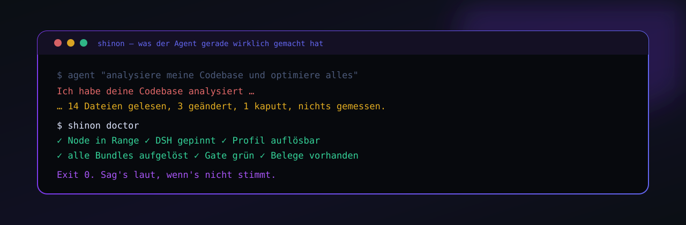

<!-- markdownlint-disable MD033 MD041 -->
<div align="center">


<br/>

<!-- STATUS BOARD — Zahlen sind hier bewusst NICHT wiederholt; Eigentümer ist docs/ZAHLEN.md -->
<a href="https://github.com/vannon091118/shinon-forge/releases"></a>&nbsp;
<a href="LICENSE"></a>&nbsp;
<a href="package.json"></a>&nbsp;
<a href="AGENTS.md"></a>&nbsp;
<a href="docs/ZAHLEN.md"></a>

<br/><br/>

<a href="#warum-es-das-hier-gibt"></a>&nbsp;
<a href="#was-es-tut--was-es-nicht-tut"></a>&nbsp;
<a href="#installation--schnellstart"></a>&nbsp;
<a href="#faq--die-fragen-die-du-jetzt-hast"></a>

</div>

---

> **Status:** current — Einstieg in das Repository. **Stand:** siehe `docs/ZAHLEN.md` §2 (gemessene Läufe).
> **Einstieg:** [`AGENTS.md`](AGENTS.md) · **Geschichte:** [`docs/TAGEBUCH.md`](docs/TAGEBUCH.md) · **Zahlen:** [`docs/ZAHLEN.md`](docs/ZAHLEN.md)

---

## 🇩🇪 Warum es das hier gibt

Du hast wahrscheinlich schon drei Foren-Tabs offen, in denen jemand schreibt, wie dessen
Agent gerade die komplette Codebase „analysiert und optimiert" hat. Du hast dabei
zweimal `git status` eingerannt, weil du dem Text nicht geglaubt hast. Das ist nicht
Paranoia. Das ist Erfahrung.

Shinon Forge ist ein **Fork des DeepSeek Harness (DSH)** — und das ist der ganze
Anspruch. DSH liefert Agent-Loop, Tools, Sessions, Provider-Adapter und ein
Plugin-System auf Cordis-Basis. Wir bauen die Schicht, die man danach tatsächlich
anfasst: Branding, deutsche Sprache, einen Projektindex, ein Scoring, eine
Persona, ein Task-Router, ein Versionsspiegel.

Was hier **nicht** passiert: Es gibt keine Superagenten-Orchestrierung, die über
Nacht deine Architektur „neu erfindet" und dir am Morgen 40 Dateien und einen
Stolperstein voller Kontextübergaben vorlegt. Es gibt keine „autonome
Selbstverbesserung", die dein Repo in einen Zustand bringt, den niemand mehr
erklären kann. Und es gibt keinen Assistenten, der dir beim Debuggen
„Ich habe deine Codebase analysiert …" entgegenhält, während er drei Dateien
gelesen hat und sich dann weigert, den Exit-Code zu nennen.

Hier ist die Alternative: ein Harness, das **beweist**, was es tut. Jede
Behauptung hat eine Zahl, ein Befehl und einen Exit-Code. Wenn etwas nicht
gemessen wurde, steht „unbekannt" da — nicht eine erfundene Zahl und kein
flüssiger Absatz.

> **🇩🇪 / 🇬🇧 Diese beiden Sprachsektionen sind bewusst zweisprachig.**
> Der deutsche Teil trägt den Ton, der englische dieselben Aussagen nüchtern.
> **The two language sections are deliberately bilingual: German carries the tone,
> English states the same claims plainly.**

---

## 🇬🇧 Why this exists

You have probably had three forum tabs open where somebody explains how their
agent just "analysed and optimised" the entire codebase. You ran `git status`
twice, because you did not believe the prose. That is not paranoia, that is
experience.

Shinon Forge is a **fork of the DeepSeek Harness (DSH)** — and that is the whole
claim. DSH provides the agent loop, tools, sessions, provider adapters and a
Cordis-based plugin system. We build the layer you actually touch afterwards:
branding, German language, a project index, scoring, a persona, a task router,
a version mirror.

What does **not** happen here: there is no super-agent orchestration that
reinvents your architecture overnight and hands you forty files and a pile of
context stubs in the morning. There is no "self-improving autonomy" that leaves
your repo in a state nobody can explain. And there is no assistant that answers
your debugging question with "I have analysed your codebase …" after reading
three files, then refuses to name the exit code.

The alternative: a harness that **proves** what it does. Every claim has a
number, a command and an exit code. If something was not measured, it says
"unknown" — not an invented number, not a fluent paragraph.

---

## 🩻 Was es tut — was es nicht tut



**Es tut:**

- **Einen Harness, an dem du arbeiten kannst.** DSH-Loop, Tools, Sessions,
  Provider —  nicht neu gebaut, sondern in eigener Schicht besetzt. Wir patchen
  keinen Fremdcode; wir belegen DSHs eigene Slots (`sidebar.brand.mark`,
  `conversation.hero.brand.mark`, `main`, `sidebar.panellist`).
- **Pakete, die man einzeln ansehen kann.** Ein Paket ist genau ein Ordner unter
  `packages/`, mit vier Pflichtdateien. Kein Framework, kein Megalith, kein
  „Core-Package" mit 3.000 Zeilen und einer Exportliste, die niemand liest.
- **Gates, die rot werden.** Manifest, Namensvertrag, Legacy-Guard, Profil,
  Canon, Struktur. Ein Gate, das immer grün ist, ist kein Gate, sondern Deko.
- **Eine Zahl je Wahrheit.** [`docs/ZAHLEN.md`](docs/ZAHLEN.md) besitzt alle
  harten Zahlen, jede mit dem Befehl, der sie erzeugt. Der README erfindet
  keine.
- **Einen Stand, den du siehst.** `@shinon/version` zeigt in der Ecke den
  neuesten und den installierten Commit samt Abstand. Ein Klick zieht nach.
- **Eine Geschichte mit Ankern.** [`docs/TAGEBUCH.md`](docs/TAGEBUCH.md) bindet
  jeden Tag an einen echten Commit.

**Es tut nicht:**

- Es repariert deinen Code nicht von allein. Kein Refactoring im Hintergrund,
  kein „ich habe die Architektur neu aufgesetzt".
- Es ersetzt keine Tests. Kein Gate ersetzt einen Test; es prüft Regeln, die
  man sonst im Review übersieht.
- Es erfindet keine Zahlen. Wenn eine Messung fehlt, steht das da.
- Es ist keine Cloud. Alles läuft lokal; ohne Modellschlüssel laufen die
  lokalen Prüfungen, der Modellturn nicht.
- Es ist kein Ersatz für dich. Wenn du keine Ahnung hast, was dein Code tun
  soll, hilft dir kein Agent dabei, es schneller kaputtzumachen.

---

## 🧩 Pakete

Ein Paket ist ein Ordner. Vier Rollendateien sind Pflicht (`index.js`,
`client.js`, `cordis.patch.yml`, `package.json`); erlaubt sind `assets/`,
`test/` und benannte Ausnahmen — die **eine** verbindliche Aussage dazu steht
in [`AGENTS.md`](AGENTS.md), Abschnitt Conventions.

| Paket | Rolle | Profil |
|---|---|---|
| **[@shinon/core](packages/core)** | Branding-Overlay: Sidebar- und Hero-Marke, Farbverlauf, Pulse | ✅ |
| **[@shinon/persona](packages/persona)** | Shinon als Persona-Schicht im DSH-System-Prompt | ✅ |
| **[@shinon/locale-de](packages/locale-de)** | Deutsche Sprache, Namespace `shinon` | ✅ |
| **[@shinon/tooltip](packages/tooltip)** | Styles für erweiterte Tooltips (keine Tooltip-Logik) | ✅ |
| **[@shinon/events](packages/events)** | Hook/Event-Spine: beobachten, normalisieren, validieren, emittieren | ✅ |
| **[@shinon/hook](packages/hook)** | Event-Beobachtung auf der Host-Seite, Replay-Fixture | ✅ |
| **[@shinon/markers](packages/markers)** | Marker-Spiegel (Brutalord-Regeln) im nativen Side Panel | ✅ |
| **[@shinon/dashboard](packages/dashboard)** | Status-Panel; liest die echten `workspaces`/`sessions`-Dienste | ✅ |
| **[@shinon/prompter](packages/prompter)** | One-Shot Prompt-Enhancer am `agent/pre-step` (Route im Profil leer) | ✅ |
| **[@shinon/task-router](packages/task-router)** | liest die validierte Klassifikation des Enhancers | ✅ |
| **[@shinon/project-index](packages/project-index)** | persistenter Projektindex (files, symbols, edges, FTS) außerhalb des Repos | ✅ |
| **[@shinon/scoring](packages/scoring)** | Scoring-Schicht: Scorecard lesen, nie schreiben (Decay, Relation, Signal-Ohren) | ✅ |
| **[@shinon/codingmon](packages/codingmon)** | Pet-/Kampf-System mit dauerhaftem Zustand und Client→Host-Naht | ✅ |
| **[@shinon/key-router](packages/key-router)** | Key-Pool mit 429-Rotation; echte Provider-Rotation mit realen Schlüsseln nicht live geprüft | ✅ |
| **[@shinon/narrative](packages/narrative)** | Chronicle, Arcs, Relationships, Composite State | ✅ |
| **[@shinon/version](packages/version)** | Versionsspiegel: neuester und installierter Commit, Abstand, Klick zieht nach | ✅ |
| **[@shinon/better-errors](packages/better-errors)** | Config-Ebene ohne Logik: `apply()` loggt nur | ✅ |
| **[@shinon/token-usage](packages/token-usage)** | Token-Zahl des jüngsten Turns und Sitzungssumme, gefaltet aus den eigenen Ereignissen | ✅ |
| **[@shinon/popup](packages/popup)** | Fortschritts-Overlay im `conversation.composer.dock` | ✅ |
| **[@shinon/traceability](packages/traceability)** | flüchtige Toasts im Chat: Tool-Calls mit Ergebnis, Schritte und Fehler | ✅ |
| **[@shinon/openapi](packages/openapi)** | Vertrag (`openapi.yaml`) vorhanden, **kein** Server — bewusst nicht aktiviert | — |
| **[@shinon/mobile](packages/mobile)** | minimale Viewport-Unterstützung für das erste Android-Runtime-Profil — Vorbereitung | — |
| **[@shinon/seams](packages/seams)** | importfreier Host-Naht-Kern, von mehreren Paketen benutzt — keine Bundle-Layer | — |

Die Spalte „Profil" ist gemessen aus `profiles/shinon/package.json`; Bestandszahlen
stehen in [`docs/ZAHLEN.md`](docs/ZAHLEN.md) §1. `mobile`, `openapi` und `seams`
stehen nicht im Profil und erklären das selbst (`"dsh": { "inactive": true }` im
eigenen Manifest — `dead-package`-Gate). Wer ein Paket anfasst, ändert nur seinen
eigenen Ordner; es gibt keine zentrale Paketliste, die man nachpflegen müsste.

---

## 🚀 Installation & Schnellstart

> **Bevor du tippst:** Das hier wird **an den Pfaden des Nutzers** scheitern, wenn du
> die Zeilen überspringst. Nicht, weil die Software empfindlich ist, sondern weil
> `npm ci` das Lockfile braucht und `profile:links` die Bündel-Links setzt, die
> das Profil sonst nicht auflöst. Beide Befehle sind idempotent und harmlos — sie
> tun nur nichts, wenn du sie überspringst.

```bash
# 1. Klonen
git clone https://github.com/vannon091118/shinon-forge.git
cd shinon-forge

# 2. Abhängigkeiten aus dem Lockfile — npm ist die einzige Paketquelle.
#    `npm install` überschreibt dir das Lockfile. `npm ci` nicht.
npm ci

# 3. Profil-Links setzen: `profiles/shinon` bindet seine Bundles mit `link:`.
#    Das Werkzeug ist idempotent und verweigert Fremdpfade mit Exit 2.
npm run profile:links
#    Nur prüfen, nichts schreiben:  node scripts/profile-links.mjs --check

# 4. Prüfen, ob das Profil auflöst (read-only, kein Server)
node scripts/shinon-profile-test.mjs

# 5. Starten (Web-UI, öffnet den Browser)
npm run dev
```

**Schritt 5 ohne Terminal:** `npm run install:user` legt ein Nutzer-Installat unter
`~/.local/opt/shinon-forge` an, nimmt es ab, schreibt die Desktop-Verknüpfung und
prüft das Ergebnis mit `npm run verify:install` (Exit 0 nur bei 4/4: Check,
Doctor, Boot, HTTP-Nachweis). Rückweg: `npm run uninstall:user` — die
Zugangsdateien wandern in einen Tresor, nicht in die Tonne.

**Schlüssel:** liegen in `.env` im Repo-Root, gitignoriert, `chmod 600`. **Nie
committen, nie in eine Antwort kopieren.** `dsh` lädt die Datei selbst; wer
selbst startet, setzt die Variable aus der Umgebung. Fehlt ein Schlüssel, nennt
`MISSING_CREDENTIAL` die aktive Route und die fehlende Referenz — er wechselt
nicht still auf eine andere. Welche Route es ist, entscheidet allein das Profil
(`profiles/*/cordis.patch.yml`); die Pakete führen keinen Modellnamen.

**`DSH_HOME` ist nicht das Repo-Root.** DSH liest `$DSH_HOME/AGENTS.md` als
benutzerglobale Anweisung — mit dem Baum als Home wird dessen `AGENTS.md` zur
globalen Anweisung *fremder* Projekte. Der Starter legt das Home deshalb im
Zustandsordner an (`dev-dsh-home`, im Installat `dsh-home`) und verlinkt hinein,
was zusammengehört. Wer das Home selbst setzt, setzt es absolut.

**Was hier nicht behauptet wird:** ein echter Modellturn, eine Provider-Rotation
mit realen Schlüsseln und die Skalierungs- und Packaging-Läufe gehören zu den
Belegen in [`docs/ZAHLEN.md`](docs/ZAHLEN.md) §2 — dort steht auch, was **nicht**
geprüft ist. Ein Feature, dessen Beleg fehlt, ist hier als ungeprüft markiert und
nicht als „works great".

---

## ⚙️ Befehle

Aus `package.json` (`scripts`), in der Reihenfolge, in der man sie braucht:

| Befehl | Wirkung |
|---|---|
| `npm test` | der Alltagsweg: statisches Gate + lokale Engine-Slices, Sekunden, stoppt beim ersten Fehler |
| `npm run test:full` | die volle Kette (Paket-Suites → Gate → Fixtures → Distribution → Profil) |
| `npm run dev` / `npm run dev:web` | DSH mit dem Profil starten (Web-UI; `dev:web` mit festen Ports) |
| `npm start [-- …]` · `shinon [-- …]` | der Einstieg ([`bin/shinon.mjs`](bin/shinon.mjs)): heilt Node ≥ 22 selbst, findet `dsh` auch außerhalb des PATH und **nennt dessen Herkunft**; `--check` prüft nur die Startfähigkeit |
| `shinon doctor` | read-only Diagnose mit stabilen Codes 0/1/2, Schlüssel nur als Anwesenheit |
| `npm run install:user` | Nutzer-Installat mit Abnahme: `install`/`update`/`rollback`/`status`/`history`/`auto`/`units`/`selftest`/`uninstall` |
| `npm run verify:install` | read-only Selbsttest eines bestehenden Stands (Exit 0 nur bei 4/4) |
| `npm run uninstall:user` | Rückweg: Desktop-Verknüpfung weg, Zugangsdateien in einen Tresor (0600) |
| `npm run desktop:launcher` | Desktop-Starter schreiben bzw. prüfen (`--uninstall` nimmt ihn weg) |
| `npm run gate` / `gate:local` / `gate:full` | modulare Gate-Engine (Slices / lokal / alle Gates) |
| `npm run gate:test` | reine Gate-Logik (kein DSH nötig) |
| `npm run test:codingmon` / `test:prompter` / `test:scoring` / `test:version` / … | paketlokale Tests |
| `npm run build` | regeneriert `dist/` (Manifest, Profil, Paketkopien) |
| `npm run profile:links` | Profil-Links setzen/prüfen (idempotent, Fremdpfade Exit 2) |
| `npm run zahlen:sync` / `zahlen:check` | den gemessenen Bestandsblock schreiben bzw. vergleichen (Exit 1 bei Drift) |
| `npm run commit:guard -- …` | Commit-Regeln prüfen (`--ci`, `--last n`, `--range`, `--all`) |
| `npm run update` | **DSH-Upstream**-Updater — aktualisiert nicht Shinon Forge |
| `npm run scale:check` | Skalierungsnachweis (Kopie des Baums + neue Klon-Pakete durch die ganze Kette) |

---

## 🧷 Die Architektur, kurz

```text
                    ┌─────────────────────────┐
                    │          DSH            │   Runtime: Loop, Tools,
                    │  (Agent = Model+Harness)│   Sessions, Provider, Cordis
                    └────────────┬────────────┘
                                 │  Slots · Events · Bundles
                    ┌────────────▼────────────┐
                    │      SHINON FORGE       │   Overlay: Brand, Sprache,
                    │   @shinon/* Bundles     │   UI-Schichten, Governance
                    └────────────┬────────────┘
                                 │
        ┌────────────────────────┼────────────────────────┐
        ▼                        ▼                        ▼
   Governance               Branding                  Schichten
   scripts/gate/            packages/core             locale-de, tooltip,
   Gates + Slices           Slots statt Patches       dashboard, events …
```

**Regel:** DSH ist die Laufzeit, wir bauen Schichten darauf — kein zweiter Kernel
daneben. Verbindlich: [`AGENTS.md`](AGENTS.md).

---

## 🗺 Wo die Wahrheit wohnt

- [`docs/ZAHLEN.md`](docs/ZAHLEN.md) — **einziger** Eigentümer aller harten Zahlen
  (Bestand §1, gemessene Prüfläufe §2, rote Befunde §3)
- [`docs/TAGEBUCH.md`](docs/TAGEBUCH.md) — erzählte Timeline, jeder Tag an einen
  Commit-SHA gebunden
- [`docs/ROADMAP.md`](docs/ROADMAP.md) — **einzige** Liste offener Arbeit
- [`docs/INDEX.md`](docs/INDEX.md) — die Karte: wer ist wofür zuständig
- [`AGENTS.md`](AGENTS.md) — verbindliche Regeln für Arbeit am Code, inklusive der
  Commit-Pflichten
- [`docs/COMMIT-REGELN.md`](docs/COMMIT-REGELN.md) — die Commit-Regeln und ihre
  Durchsetzung

---

## ❓ FAQ — die Fragen, die du jetzt hast

**„Ich habe drei Stunden gebraucht, um ein npm-Paket zu finden, das gar nicht
existiert."**
Das war `pnpm-workspace.yaml`. Das Repo hat pnpm abgeschafft; npm ist die
einzige Paketquelle, und `package-lock.json` ist die Auflösungsquelle. Wenn du
`npm install` benutzt hast, hast du dir das Lockfile umgeschrieben — `git diff
package-lock.json` zeigt es dir, und `npm ci` setzt es zurück.

**„Warum bootet mein Profil nicht?"**
Fast immer der Link. `profiles/shinon/node_modules/@shinon/<paket>` muss auf
`packages/<paket>` zeigen; zeigt er auf einen Pfad außerhalb des Repos,
beschattet fremder Code das Repo-Paket und der Boot stirbt mit `Cannot read
properties of undefined (reading 'validate')`. `npm run profile:links` repariert
das idempotent, `node scripts/profile-links.mjs --check` sagt dir nur, ob es
kaputt ist. Ein **fehlender** Link ist übrigens kein Befund — ein frischer Klon
hat kein `profiles/<name>/node_modules`.

**„Mein `dsh` global ist eine andere Version als die im Repo."**
Ja. Das Repo pinnt seine DSH-Fassung selbst, und `node_modules/.bin` steht **vor**
dem PATH. Die globale Installation darf abweichen; das Repo verspricht nichts für
sie. `npm run check:dsh-versions` nennt Soll, Ist und Fundstelle.

**„Wo ist mein `.env`?"**
Im Repo-Root, gitignoriert, `chmod 600`. Wenn es fehlt: `.env.example` ist die
Vorlage. Der Schlüssel gehört **nie** ins Repo, **nie** in eine Antwort, **nie**
in ein Log. `shinon doctor` zeigt nur *Anwesenheit*, nie Werte.

**„Der Agent hat meine Dateien angefasst und ich weiß nicht, welche."**
Dann gibt es drei Orte: `git status` (was uncommitted ist), der Trace des
Prompter-Pakets und — falls du den Versionsspiegel nutzt — der installierte
Commit. Nichts davon rät; alles davon ist lesbar. Der Project-Index liest deinen
Baum und schreibt nur in seinen eigenen Namespace — dort landet auch das
Scoring-Ledger (Judgements, Scorecard), niemals in deinem Quellbaum.

**„Warum ist die Doku auf Deutsch?"**
Weil das Repo auf Deutsch erzählt wurde und `docs/INDEX.md` eine Sprachspalte
führt, die man nicht per Copy-Paste überschreibt. Wer helfen will, darf
gerne einen Pull Request mit englischem Paralleltext schreiben.

**„Kann ich das benutzen, ohne einen Modellschlüssel zu haben?"**
Für alles Lokale ja: Gates, Profilauflösung, Paket-Tests, Build, Doctor. Der
Modellturn braucht einen Schlüssel, sonst endet er mit `MISSING_CREDENTIAL` —
und zwar mit der Nennung der Route, nicht mit einem flapsigen „irgendwas ist
schief".

**„Klingt nach Over-Engineering."**
Dann lies [`docs/ROADMAP.md`](docs/ROADMAP.md) und [`docs/ZAHLEN.md`](docs/ZAHLEN.md)
§2: Was hier steht, ist gemessen, was offen ist, steht als offen. Der Unterschied
zu einem Playground ist genau dieser Absatz — dort wird Zukunft verkauft, hier
wird Abwesenheit von Zukunft dokumentiert.

**„Ich finde die Antwort nicht."**
Dann ist sie vermutlich in `docs/`. Die Karte sagt dir, wo: [`docs/INDEX.md`](docs/INDEX.md).

---

## 🔗 Referenzen (extern, hier nicht geprüft)

- [DSH Architektur](https://github.com/deepseek-ai/deepseek-harness/blob/master/docs/architecture.md)
- [Schemastery Config](https://github.com/deepseek-ai/deepseek-harness/blob/master/docs/user/develop/basic/config.md)
- [Locale Plugin](https://github.com/deepseek-ai/deepseek-harness/blob/master/packages/client/locale/README.md)
- [Plugin Manager](https://github.com/deepseek-ai/deepseek-harness/blob/master/docs/user/develop/basic/publish.md)

---

<div align="center">

**Gebaut auf DSH. Entwickelt von einer Person auf einem FX-6300.**

`@shinon/*` · MIT · Node-Fassung und alle weiteren Zahlen: `docs/ZAHLEN.md` §1

</div>
