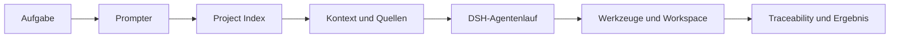

<!-- markdownlint-disable MD033 MD041 -->
<div align="center">


# Shinon Forge

### Agentenarbeit nachvollziehbar machen. `git status` darf mitreden.

[](LICENSE)
[](package.json)
[](docs/INDEX.md)

**Shinon Forge ist ein eigenständiger Fork auf Basis des DeepSeek Harness (DSH).** DSH bleibt die Laufzeit. Shinon ergänzt gezielte Pakete, Kontextarbeit und überprüfbare Verträge darum herum.

</div>

## Was Shinon ergänzt

| Bereich | Aufgabe |
|---|---|
| **Prompter** | Ordnet die Anfrage ein und ergänzt passenden Kontext für den Modellturn. |
| **Project Index** | Findet relevante Quellen im ausgewählten Workspace und wahrt dessen Grenzen. |
| **Persona und Task-Router** | Trennen Identität, Zielverfolgung und gespeicherte Signale. |
| **Key-Router** | Verwaltet konfigurierte Schlüssel-Pools und Rotationsregeln, ohne still die Modellroute zu wechseln. |
| **Traceability** | Macht aktive Komponenten und beobachtete Schritte nachvollziehbar. |
| **Codingmon** | Ein Begleiter mit persistentem Spielstand, getrennt von den eigentlichen Entwicklungs-Gates. |

## Ablauf



Das ist der beabsichtigte Ablauf, kein Beweis für jeden möglichen Modellpfad. Konkrete Zusagen und ihre Prüfungen stehen in [CI und Gates](docs/CI-UND-GATES.md) und [Messwerten](docs/ZAHLEN.md).

## Schnellstart

Voraussetzung: Git, npm und eine von `package.json` unterstützte Node-Version.

```bash
git clone https://github.com/vannon091118/shinon-forge.git
cd shinon-forge
npm ci
npm run profile:links
npm run dev
```

`npm ci` installiert das Lockfile; `profile:links` richtet die lokalen Paketverknüpfungen ein. Für echte Modell-Turns muss die gewählte Route Zugangsdaten besitzen. Nutze `.env.example` als Vorlage für die lokale `.env`; Schlüsselwerte gehören weder in Git noch in Diagnoseausgaben. Profilauflösung und viele lokale Prüfungen funktionieren auch ohne Modellschlüssel.

Nach der Einrichtung zeigt `git status --short` keine Änderungen, die allein durch Installation und Profilverknüpfung entstanden sind. `.freebuff/`, Credentials, Sitzungsdaten, Logs und temporäre Agentenausgaben bleiben lokal. Kuratierte Prüfbelege in `docs/probes/` werden dagegen versioniert, wenn sie einen konkreten Vertrag belegen. Details dazu stehen in [Remote-Arbeit und Worktrees](docs/REMOTE-ARBEIT.md).

## Entwicklung und Prüfungen

```bash
npm test
```

`npm test` ist der schnelle lokale Pfad: statisches Gate plus gezielte Engine-Slices. Für einzelne Bereiche gibt es beispielsweise `npm run test:prompter` und `npm run test:codingmon`. Die vollständige Pflichtkette läuft in GitHub Actions; ein grüner lokaler Test ersetzt sie nicht. Vor Änderungen bitte [AGENTS.md](AGENTS.md) lesen und die tatsächlichen Änderungen mit `git diff` prüfen.

## Release-Status

Shinon Forge ist in der Abnahme für **v0.4.0**, noch kein Stable-Release. Der kanonische Umfang und die offenen Freigabekriterien stehen in [docs/ROADMAP.md](docs/ROADMAP.md). Ein einzelner Test, ein Modellturn oder ein grüner älterer Lauf ist kein Release-Nachweis.

## Dokumentation

| Wenn du wissen willst … | Einstieg |
|---|---|
| Was aktuell dokumentiert ist | [Dokumentationskarte](docs/INDEX.md) |
| Installation, Profile und Zugangsdaten | [Setup](docs/SETUP.md) |
| Architektur und Paketgrenzen | [Architektur](docs/ARCHITEKTUR.md) · [Pakete](docs/PAKETE.md) |
| Prüfungen und CI-Verträge | [CI und Gates](docs/CI-UND-GATES.md) |
| Offene Arbeit | [Roadmap](docs/ROADMAP.md) |
| Bestände und Messbelege | [Zahlen](docs/ZAHLEN.md) |
| Zusammenarbeit zwischen Agenten | [Agenten-Übergabe](docs/AGENT-HANDOFF.md) |
| Änderungen und historische Belege | [Changelog](docs/CHANGELOG.md) · [Entwicklungstagebuch](docs/TAGEBUCH.md) |

## Häufige Fragen

**Ist Shinon ein zweiter Harness?** Nein. DSH stellt den Agenten-Loop, die Werkzeuge, Sitzungen, Provider und das Plugin-System bereit. Shinon ergänzt Funktionen an den vorgesehenen Schnittstellen.

**Ändert ein Agent Dateien automatisch?** Er kann verfügbare Werkzeuge verwenden. Prüfe immer `git status` und den Diff; ein Bericht über eine Datei ist kein Beweis, dass sie tatsächlich geprüft oder geändert wurde.

**Wo stehen offene Aufgaben?** Ausschließlich in [docs/ROADMAP.md](docs/ROADMAP.md). Erledigte Arbeit gehört mit konkreten Belegen in das [Entwicklungstagebuch](docs/TAGEBUCH.md).

---

<div align="center">

`@shinon/*` · MIT · [Lizenz](LICENSE)

</div>
