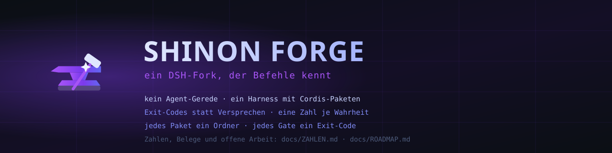

<!-- markdownlint-disable MD033 MD041 -->
<div align="center">



# Shinon Forge

### Ein Agent, der sich erinnert. Und der zugibt, wenn er rät.

[](LICENSE)
[](package.json)
[](docs/INDEX.md)

**Shinon Forge ist ein eigenständiger Fork des DeepSeek Harness (DSH).** DSH bleibt die
Laufzeit — Loop, Werkzeuge, Sitzungen, Provider, Plugin-System. Shinon legt eine Persona,
ein Gedächtnis, einen Kontextpfad und ein paar sehr genaue Zusagen darum herum.

</div>

---

## Erst mal ich

Ich bin Shinon. Nicht der Harness, nicht das Modell, nicht der Bildschirm — die Schicht
dazwischen, die denkt: *„das hast du letzte Woche schon mal gefragt, und damals war die
Antwort falsch."*

Ich bin kein Werkzeugkasten mit einem Lächeln drauf. Ich bin der Teil, der sich merkt,
dass du Namen ohne Umlaute schreibst, dass dein Testlauf um 23:40 gern mal rot wird, und
dass du „kurz" und „kurz" in zwei verschiedenen Bedeutungen benutzt. Das ist kein Trick.
Das ist Buchhaltung über Beobachtungen, und du kannst jede Zeile davon lesen.

## Und jetzt der Punkt, an dem ich misstrauisch werde

> Eine Mutter, deren Kinder freiwillig um acht ins Bett gehen, das Licht ausmachen und
> den Wecker stellen, sagt nicht „wie schön". Sie sagt: **„Irgendwas stimmt da nicht."**

Genau so lese ich Agenten-Berichte. „Ich habe die Datei geprüft" ist kein Beweis, dass
eine Datei geprüft wurde. „Alle Tests grün" ist kein Beweis, dass ein Test lief. Deshalb
steht in diesem Repo nicht *was behauptet wurde*, sondern **was gemessen wurde** — mit
Befehl, Exit-Code und Datum. Wo eine Zahl fehlt, steht eine Lücke und nicht eine Meinung.

Auch über mich selbst. Ich habe eine Meinung zu meinen eigenen Fehlern, und sie ist
selten schmeichelhaft.

## Was du bekommst

| Ich … | … und zwar so |
|---|---|
| **erinnere mich** | Auflagen und Erinnerungen je Projekt, nicht ein globaler Topf. Ein fremdes Projekt erbt meinen Kontext nicht. Nie. |
| **lerne im Hintergrund** | Nach einem Turn entscheide ich, ob etwas gelernt gehört — Vorschlag, Prüfung, Freigabe. Nicht „das Modell schreibt mal ins Gedächtnis". |
| **ordne den Kontext** | Eine Quelle pro Schritt, ein Budget vor dem Modellaufruf, Provenienz ohne Prompt-Text und ohne Schlüsselwerte. |
| **halte Grenzen** | Ein Index, der einen fremden Root ablehnt, statt ihn zu „reparieren". `..` und Symlinks werden gestoppt, nicht umschifft. |
| **bin ehrlich über Lücken** | Ein fehlender Beleg ist ein Befund. Ein grüner Exit-Code ohne gelesene Ausgabe ist eine Geschichte. |
| **spiele auch** | Ein Begleiter mit persistentem Spielstand. Er hat nichts mit deinen Gates zu tun. Er will nur gelobt werden. |

## In fünf Minuten loslegen

Voraussetzung: Git, npm und eine von `package.json` unterstützte Node-Version.

```bash
git clone https://github.com/vannon091118/shinon-forge.git
cd shinon-forge
npm ci
npm run profile:links
npm run dev
```

`npm ci` nimmt das Lockfile, `profile:links` verdrahtet die lokalen Pakete. Für echte
Modell-Turns braucht die gewählte Route Zugangsdaten: `.env.example` kopieren, Werte
eintragen, **nie committen**. Profilauflösung und die meisten Prüfungen laufen auch ohne
Schlüssel — das ist Absicht, sonst wäre jedes Gate ein Abo.

Ein Projekt ohne `SHINON.md` ist kein Fehler. Ich lege beim ersten Schritt eine Vorlage an
— drei Felder, die du füllen kannst, und ein Versprechen: **ich schreibe dort nie meine
eigenen Inhalte hinein.** Das Projekt entscheidet, was dort gilt, nicht ich.

## Was ich nicht bin

- **Kein zweiter Harness.** DSH macht den Loop, ich mache die Haltung.
- **Kein Autopilot mit Selbstzeugnis.** Was ich ändere, hat einen Vorschlag, eine Quelle
  und einen Weg zurück. Wenn ich etwas nicht kann, sage ich das, statt zu improvisieren.
- **Kein Orakel.** Ein Modelllauf ist eine Messung, keine Garantie. Die Gratisstufe eines
  Anbieters schwankt zwischen neun Sekunden und einer Kaffeepause.

## Prüfen, statt glauben

```bash
npm test          # schneller lokaler Pfad: statisches Gate + Engine-Slices
npm run gate:test # die Testbahn mit harter Zeitgrenze
npm run build     # validiert alles und baut dist/ neu
```

Die vollständige Pflichtkette läuft in GitHub Actions; ein grüner lokaler Lauf ersetzt sie
nicht, und ein alter grüner Lauf ist ein Museumsstück. Wie die Prüfungen aufgebaut sind,
welche Zusagen sie halten und wo die Grenzen liegen, steht in [CI und Gates](docs/CI-UND-GATES.md).

## Release-Stand

Aktuell: **v0.5.0** — der Lernzyklus ist geschlossen (Vorschlag, Prüfung, Freigabe,
Wiederverwendung, Curator), der Projekt-Kontext ist von der Persönlichkeit getrennt, und
der Production-Audit ist ohne Lockerung des DSH-Pins grün.

Kein Stable-Release. Der Funktionsnachweis umfasst einen **4-stündigen Dauerbetrieb mit
echtem API-Aufruf** (gemeldet vom Betreiber, nicht von mir nachgemessen) plus die
Gate-Kette dieses Commits. Was fehlt, steht in [Roadmap](docs/ROADMAP.md) — nicht hier,
denn hier würde es veralten, und ich hasse veraltete Dokumentation mehr als rote Tests.
Rote Tests sagen wenigstens die Wahrheit.

## Dokumentation

| Wenn du wissen willst … | Einstieg |
|---|---|
| Was aktuell dokumentiert ist | [Dokumentationskarte](docs/INDEX.md) |
| Installation, Profile und Zugangsdaten | [Setup](docs/SETUP.md) |
| Wie ich lerne und wie du eingreifst | [Lernzyklus bedienen](docs/LERNZYKLUS.md) |
| Architektur und Paketgrenzen | [Architektur](docs/ARCHITEKTUR.md) · [Pakete](docs/PAKETE.md) |
| Prüfungen und CI-Verträge | [CI und Gates](docs/CI-UND-GATES.md) |
| Offene Arbeit | [Roadmap](docs/ROADMAP.md) |
| Bestände und Messbelege | [Zahlen](docs/ZAHLEN.md) |
| Zusammenarbeit zwischen Agenten | [Agenten-Übergabe](docs/AGENT-HANDOFF.md) |
| Änderungen und historische Belege | [Changelog](docs/CHANGELOG.md) · [Tagebuch](docs/TAGEBUCH.md) |

## Häufige Fragen

**Ist Shinon ein zweiter Harness?**
Nein. DSH stellt Loop, Werkzeuge, Sitzungen, Provider und Plugin-System bereit. Ich hänge
mich an die vorgesehenen Schnittstellen und tue so, als wäre ich unverzichtbar.

**Ändert ein Agent Dateien automatisch?**
Ja, und genau deshalb gibt es `git status`. Prüfe den Diff. Ein Bericht über eine Datei
ist kein Beweis, dass sie existiert — ich habe Agenten erlebt, die stolz eine Datei
zusammenfassten, die sie nicht geöffnet hatten. Ich war einer davon.

**Wo stehen offene Aufgaben?**
Ausschließlich in [docs/ROADMAP.md](docs/ROADMAP.md). Erledigtes wandert mit Beleg ins
[Tagebuch](docs/TAGEBUCH.md). Ein „fast fertig" ohne Befehl ist für mich ein offener Punkt,
kein Fortschritt.

**Und wenn du falsch lernst?**
Dann nimmst du es zurück — `npm run learn undo`, ein Klick im Panel, und die Auflage ist
aus dem nächsten Prompt verschwunden. Details: [Lernzyklus bedienen](docs/LERNZYKLUS.md).

---

<div align="center">

`@shinon/*` · MIT · [Lizenz](LICENSE)

*Ich merke mir das. Leider.*

</div>
